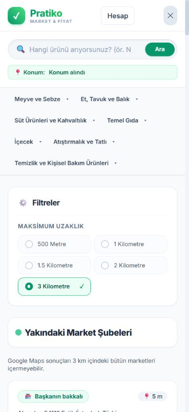
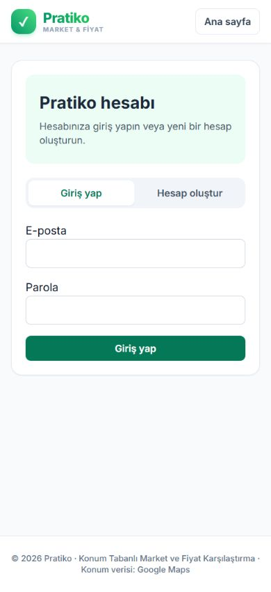

# Pratiko

Pratiko, kullanıcıların konumlarının 3 km çevresindeki market şubelerini keşfetmelerini ve mevcut fiyat bilgilerini kaynaklarıyla birlikte incelemelerini sağlayan konum tabanlı bir web uygulamasıdır.

## Projenin Amacı

Yakındaki market şubelerini keşfetmeyi ve ürün fiyatlarını tek bir platformda incelemeyi amaçlar. Şube keşfi Google Places API (New) üzerinden yapılır. Fiyat verileri, yönetici onayından geçmiş market sahibi bildirimlerinden ve BİM’in resmî kampanya kataloğundan gelir. Bu iki veri türü ayrı gösterilir.

## Öne Çıkan Özellikler

- Tarayıcı konumuyla 3 km çevresindeki market şubelerini keşfetme ve mesafe filtreleri.
- Ürün arama, 7 ana kategori, 66 alt kategori ve sayfalama.
- Fiyat kaynağı, fiyat kapsamı ve veri zamanı bilgilerini görüntüleme.
- Fiyatı bulunmayan ürünleri tahmini değer üretmeden gösterme.
- Şube sahipliği başvurusu, tekli fiyat girişi ve CSV/XLSX dosya aktarımı.
- Yönetici onayı ve ret süreci, ret gerekçeleri ve fiyat geçmişi.

## Ekran Görüntüleri

Ana sayfa görüntüleri sabit test konumuyla alınmıştır. Şube konumları Google Places üzerinden sağlanır.


| Mobil ana sayfa | Hesap ekranı |
| --- | --- |
|  |  |

Aşağıdaki paneller demo hesapları ve demo şube bilgileriyle hazırlanmıştır.

| Market sahibi paneli — Demo | Yönetici paneli — Demo |
| --- | --- |
|  |  |

## Kullanılan Teknolojiler

- **Frontend:** React 19, Vite, Tailwind CSS 3, Axios
- **Backend:** Python, Flask, SQLAlchemy, SQLite
- **Market keşfi:** Google Places API (New)
- **Test:** pytest, Vitest, React Testing Library

## Proje Yapısı

```text
backend/            Flask API, veri kaynakları, veritabanı geçişleri ve testler
frontend/           React arayüzü, API istemcisi ve frontend testleri
docs/               Ekran görüntüleri ve teknik dokümantasyon
.github/workflows/  CI iş akışı
```

## Kurulum ve Çalıştırma

Gereksinimler: Python 3.11+ ve Node.js 22.13+ veya 24 LTS.

Backend ve frontend komutlarını proje kök dizininden başlayarak iki ayrı PowerShell terminalinde çalıştırın.

### Backend

```powershell
cd backend
python -m venv venv
.\venv\Scripts\python.exe -m pip install -r requirements.txt
Copy-Item .env.example .env
```

[Ortam değişkenleri örneğini](backend/.env.example) kullanarak `backend/.env` dosyasında aşağıdaki değerleri tanımlayın.

- `GOOGLE_MAPS_API_KEY`: Google Places API erişimi için.
- `PRATIKO_SESSION_SECRET`: Hesap ve oturum işlemleri için en az 32 karakterlik rastgele bir değer.

Ardından backend'i başlatın:

```powershell
.\venv\Scripts\python.exe app.py
```

### Frontend

```powershell
cd frontend
npm ci
npm start
```

Frontend `http://localhost:3000`, backend API ise `http://localhost:5000` adresinde çalışır. Yakındaki şubeleri görüntülemek için tarayıcı konum izni verilmelidir. Konum erişimi HTTPS veya localhost üzerinden kullanılmalıdır.

## Testler

Backend testlerini `backend/` dizininde çalıştırın:

```powershell
$env:DATABASE_URI = 'sqlite:///:memory:'
.\venv\Scripts\python.exe -m pytest -q
Remove-Item Env:DATABASE_URI
```

Frontend testlerini ve production derlemesini `frontend/` dizininde çalıştırın:

```powershell
npm test
npm run build
```

13 Kasım 2026 tarihli yerel denetimde 30 backend testi, 11 frontend testi ve production build başarılı olmuştur.

## Yayınlama

Pratiko henüz canlı ortama dağıtılmamıştır. Yayın için frontend derlemesinden önce `REACT_APP_API_URL` değişkenini canlı HTTPS API adresine ayarlayın. Yayın sahibi `GOOGLE_MAPS_API_KEY`, `CORS_ORIGINS` ve güvenli oturum ayarlarını backend ortamında tanımlar.

Docker Compose yapılandırması ve CI iş akışı yerel ortamda kontrol edilmiştir. Docker Engine ve GitHub Actions runner üzerinde çalışma henüz doğrulanmamıştır.

## Bilinen Sınırlamalar

- Google Places sonuçları yoğun bölgelerde 3 km içindeki tüm şubeleri kapsamayabilir.
- Kampanya fiyatları ayrı gösterilir ve şube fiyatı karşılaştırmasının dışında tutulur.
- Market sahibi tarafından gönderilen fiyatlar, yönetici onayından sonra yayımlanır.

[Veri kaynakları, yönetici kurulumu ve dağıtım ayrıntıları](docs/teknik-rehber.md)
