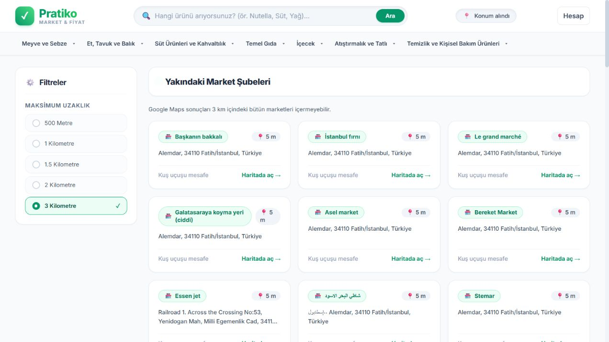
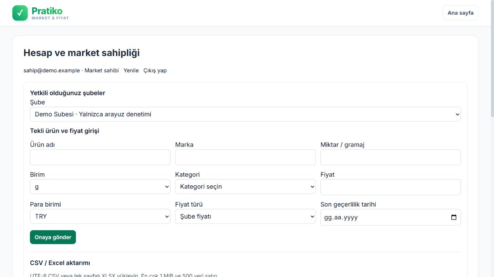
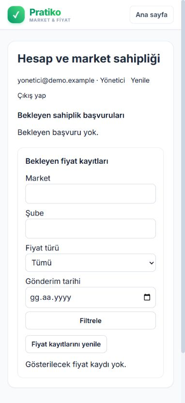

# Pratiko

Pratiko, tarayıcı konumunun 3 km çevresindeki marketleri keşfeder. Erişilebilir resmî kampanya katalogları ile market sahiplerinin gönderdiği, yönetici onaylı fiyatları aynı arayüzde kaynak ve kapsam bilgisiyle gösterir.

## Özellikler

- Tarayıcı konumu, Google Places keşfi ve 500 m, 1 km, 1,5 km, 2 km ve 3 km mesafe filtreleri.
- Şube kimliğiyle tekilleştirme ve kuş uçuşu mesafe hesabı.
- Ürün araması, yedi ana kategori, 66 alt kategori ve sayfalama.
- Kaynak bağlantısı, fiyat kapsamı, katalog etiketi ve verinin alındığı zaman.
- Şube sahipliği başvurusu, tekli fiyat girişi, CSV/XLSX önizleme ve aktarım, yönetici onayı ve fiyat geçmişi.
- Doğrulanmış teklif bulunamadığında `price: null` ve `price_status: UNAVAILABLE`.

## Teknolojiler ve mimari

React 19, Vite, Tailwind CSS 3 ve Axios ile geliştirilen istemci Flask API'yi çağırır. Backend, mevcut SQLAlchemy modellerini ve SQLite yapılandırmasını korur. Market keşfi, sağlayıcı adaptörleri ve `CanonicalProductDTO` ayrı katmanlardır. BİM kampanya kataloğu bellek içinde 15 dakika önbelleğe alınır. Google Places sonuçları kalıcı olarak saklanmaz veya sunucuda önbelleğe alınmaz.

```text
Tarayıcı → Flask API → Google Places Nearby Search → 3 km mesafe ve şube kimliği
                    → Market adaptörleri ve onaylı sahip fiyatları → karşılaştırma → sayfalama
Hesap paneli → Şube başvurusu → Yetkili sahip gönderimi → Yönetici kararı → Yayın
```

## Klasör yapısı

```text
backend/
  adapters/       Resmî kaynak uyarlayıcıları
  controllers/    Flask API ve yetki kontrolleri
  services/       Keşif, aktarım, inceleme ve fiyat yayını
  migrations/     Sürümlü SQLite SQL geçişleri
  tests/          Pytest ve hibrit akış testleri
frontend/
  src/components/ Arama, hesap, sahip ve yönetici arayüzü
  src/services/   API istemcileri
docs/             Ekran görüntüleri ve bağımlılık incelemesi
```

## Yerel kurulum

Python 3.11+ ve Node.js 22.13+ (22.x veya 24 LTS) gerekir. Backend ve frontend komutlarını ayrı PowerShell terminallerinde çalıştırın.

```powershell
cd backend
python -m venv venv
.\venv\Scripts\python.exe -m pip install --upgrade pip
.\venv\Scripts\python.exe -m pip install -r requirements.txt
Copy-Item .env.example .env
# backend/.env içinde GOOGLE_MAPS_API_KEY ve PRATIKO_SESSION_SECRET değerlerini ayarlayın.
.\venv\Scripts\python.exe app.py
```

```powershell
cd frontend
npm ci
npm start
```

İstemci `http://localhost:3000` adresinde, API `http://localhost:5000` adresinde açılır. `127.0.0.1:3000` ile açarsanız istemci API için de `127.0.0.1` kullanır. Port 3000 ve 5000 başka uygulamalar tarafından kullanılmamalıdır. Flask geliştirme sunucusu yerel kullanım içindir. API bağlantısını `/api/v1/health` ile kontrol edebilirsiniz. Konum için HTTPS veya localhost ve tarayıcı izni gerekir. Google Cloud projesinde Places API (New) etkin olmalı. Adres etiketini kullanmak için Geocoding API de etkinleştirilebilir. Anahtarı yalnızca backend'de tutun. `CORS_ORIGINS` izin verilen arayüz adreslerini virgülle ayırır. Uzak dağıtımda frontend build öncesi `REACT_APP_API_URL` değerini HTTPS API adresine ayarlayın.

```text
GET /api/v1/health
GET /api/nearby-markets?lat=41.0082&lon=28.9784
GET /api/v1/market-search?lat=41.0082&lon=28.9784&query=pirinç&radius_km=3&page=1&page_size=50
GET /api/v1/market-search?lat=41.0082&lon=28.9784&category=Temel%20Gıda
```

Koordinatlar şube keşfi ve adres çözümleme için Google Maps'e gönderilir. Üretimde dağıtım ortamının konum içeren sorgu dizelerini erişim günlüklerinden hariç tutacak şekilde yapılandırılması gerekir. [Google Places kullanım kuralları](https://developers.google.com/maps/documentation/places/web-service/policies)

## HTTPS ile yayınlama

- Arayüzü HTTPS üzerinden sunun. Frontend derlemesinden önce `REACT_APP_API_URL` değerini HTTPS API adresine ayarlayın. Aynı origin üzerinden `/api` isteklerini Flask'a ileten bir proxy varsa bu değer arayüzün HTTPS origin'i olabilir. Değer boşsa production derlemesi yerel API adresini kullanır.
- Backend'de `CORS_ORIGINS` ile izin verilen arayüz origin'lerini tanımlayın. Hesap akışları için arayüz ve API'yi aynı site altında tutun, `PRATIKO_SESSION_SECURE=1` ve gizli bir `PRATIKO_SESSION_SECRET` ayarlayın.
- Yayın sahibinin Google Cloud projesinde faturalandırmayı ve Places API (New) hizmetini etkinleştirin. Adres çözümleme kullanılacaksa Geocoding API'yi de etkinleştirin. Anahtarı yalnızca backend'in gizli `GOOGLE_MAPS_API_KEY` değişkeninde saklayın. Kullanıcıların anahtar eklemesi gerekmez.
- Google Cloud'da anahtarı kullanılan API'lerle ve backend'in sabit çıkış IP adresleriyle sınırlandırın. Yerel geliştirme ve yayın için ayrı anahtarlar kullanın. [Google Maps API anahtarı güvenlik rehberi](https://developers.google.com/maps/api-security-best-practices)

## Hesap ve şube sahipliği

Yerel geliştirme için `backend/.env` dosyasında en az 32 karakterlik rastgele bir
`PRATIKO_SESSION_SECRET` tanımlayın. Bir değer üretmek için
`python -c "import secrets; print(secrets.token_urlsafe(48))"` kullanabilirsiniz.
HTTPS dağıtımında `PRATIKO_SESSION_SECURE=1` ayarlayın. Tarayıcı oturumu için
frontend ve API aynı siteyi kullanmalı. Yerelde her iki adres için de `localhost`
kullanın veya her ikisini de `127.0.0.1` olarak yapılandırın.

Yönetici hesabını backend dizininde aşağıdaki komutla oluşturun. Parola gizli
istemle alınır.

```powershell
.\venv\Scripts\python.exe -m flask --app app create-admin yonetici@example.com
```

Hesap menüsünde kullanıcı şube sahipliği başvurusu gönderir. Yönetici
işletmenin sunduğu bilgileri ve şube kimliğini teyit edip başvuruyu onaylar
veya gerekçeyle reddeder. Onay, ilgili şubeyi hesaba bağlar.
SQLite geçişleri uygulama başlangıcında sırayla uygulanır ve `schema_migration`
tablosuna kaydedilir. Uygulama `001` hesap ve sahiplik, `002` katalog ve aktarım,
`003` fiyat onayı, `004` başlangıç kategorileri, `005` oturumlar ve `006` eksik
standart kategoriler geçişlerini bu sırayla uygular. Yeni veritabanı 7 ana ve 66
alt kategoriyle başlar. `006` mevcut kategori kimliklerini ve ürün bağlantılarını korur. Çıkış
ilgili oturumu sunucuda iptal eder. Sürüm yükseltmesinden sonra yeniden giriş yapın.

### Docker Compose ile yerel kurulum

Docker Engine ve Docker Compose kuruluysa, aynı `backend/.env` dosyasını kullanarak proje kökünden çalıştırın:

```powershell
docker compose --env-file backend/.env up --build -d
docker compose --env-file backend/.env ps
docker compose --env-file backend/.env exec backend python -m flask --app app create-admin yonetici@example.com
```

Arayüz `http://localhost`, API sağlık kontrolü `http://localhost:5000/api/v1/health` adresindedir. Varsayılan Compose CORS ayarı yerel arayüzü kapsar; yalnızca farklı bir origin kullanacaksanız `PRATIKO_DOCKER_CORS_ORIGINS` ayarlayın. Servis portları yerel bilgisayara açıktır. Backend önce migration'ları uygular; frontend, sağlık kontrolünden sonra başlar.

SQLite dosyası `pratiko_data` veri birimindedir. `docker compose --env-file backend/.env restart` ve `down` veriyi korur; `down -v` veri birimini siler. Eski bir konteynerde `/app/pratiko.db` varsa yeniden oluşturmadan önce dosyayı yedekleyin. Compose yapılandırması denetlendi. Bu bilgisayarda Docker Engine olmadığı için imaj derleme, temiz kurulum ve konteyneri yeniden başlatma doğrulanmadı.

## Market sahibi ürün girişi ve aktarım

Hesap panelinde yetkili olduğunuz şubeyi seçip tekli ürün ve fiyat girebilir
veya dosya yükleyebilirsiniz. Gönderiler `PENDING` durumunda saklanır. Yönetici bunları inceleyip onaylar veya
bir gerekçeyle reddeder. Market sahibi şube fiyat geçmişinde durumu ve ret gerekçesini görür.

Aktarım için en çok 1 MiB, 500 veri satırı ve tek çalışma sayfası kullanın.
CSV, UTF-8 kodlamalı ve virgül veya noktalı virgülle ayrılmış olabilir.
Excel için makro içermeyen `.xlsx` kullanın. Dosyada aşağıdaki sütunlar olmalı.

```text
name,brand,quantity,unit,category_id,price,currency,price_scope,valid_until
```

- `category_id` değerleri tekli formun kategori listesindeki numaralardır.
- Birimler `g`, `kg`, `ml`, `l` ve `adet`. Kg ve l, ürün eşleşmesi için g ve ml'ye çevrilir.
- Para birimleri `TRY`, `EUR`, `USD`. Fiyat türleri `BRANCH`, `ONLINE`, `CAMPAIGN`.
- Geçerlilik tarihi `YYYY-AA-GG` biçiminde veya bir Excel tarih hücresi olmalı.

Önizleme geçerli ve hatalı satırları ayrı gösterir. Kısmi gönderimde geçerli
satırları açıkça onaylayın. Başarılı gönderimde aynı dosya, adı değişse bile
aynı şube için ikinci kez kaydedilmez. Düzeltilen satırları ayrı bir dosyada
yeniden gönderebilirsiniz. Önizleme 15 dakika geçerlidir.

Arama, şube ve ürün başına her fiyat türü ve para birimi için en son gönderilmiş
onaylı kaydı kullanır. Son geçerlilik günü Türkiye saatine göre dahildir.
Onay bekleyen yeni kayıt önceki onaylı fiyatı etkilemez. Yeni onaylı fiyatın
süresi dolduğunda eski fiyat tekrar yayımlanmaz. Sahip fiyatları kartta kaynak
bilgisiyle gösterilir. Sahip kampanyaları ve kataloglar karşılaştırma dışında
tutulur.

## Veri kaynakları ve kapsam

| Kaynak | Son canlı kontrol | Uygulamadaki kapsam |
| --- | --- | --- |
| [BİM resmî sitesi](https://www.bim.com.tr/) | HTTP 200, fiyatlı kampanya kartları ayrıştırıldı | `CATALOG`. Kaynakta yayınlanan kampanya, stok ve şube fiyatı belirsiz. |
| [Migros](https://www.migros.com.tr/) | Perakende araması HTTP 403. Resmî Toptan sayfası HTTP 200, koli koşulları var | Ayrıştırıcı sabit örnekle test edildi. Çalışan ürün akışında fiyat yok. |
| [CarrefourSA](https://www.carrefoursa.com/robots.txt) | Arama ve alternatif marka sayfası HTTP 403. Arama yolu robots.txt ile hariç | Ayrıştırıcı sabit örnekle test edildi. Çalışan ürün akışında fiyat yok. |
| [ŞOK](https://www.sokmarket.com.tr/) | Ana sayfa HTTP 200. İzinli fiyat beslemesi doğrulanmadı | Kullanılabilir fiyat entegrasyonu yok. |
| [A101](https://www.a101.com.tr/market) | Market ve Kapıda yolları HTTP 403 | Kullanılabilir fiyat entegrasyonu yok. |
| [FİLE](https://www.file.com.tr/icerik/8/file-online-satis) | Tanıtım HTTP 200. Online alışveriş üye ve adres bazlı uygulama üzerinden | Kullanılabilir fiyat entegrasyonu yok. BİM'den ayrı tanınır. |
| Bağımsız ve diğer marketler | Google Places üzerinden şube keşfi | Keşif ve mesafe. Sahip fiyatları yönetici onayından sonra kaynak etiketiyle yayımlanır. |

`ONLINE` fiyatın web kanalına, `BRANCH` doğrulanmış fiziksel şubeye, `CATALOG` yayımlanmış kampanya ilanına ait olduğunu belirtir. EN UCUZ etiketi, aynı ürün ve para birimi için aynı kapsamda birden fazla satıcıdan uygun fiyat bulunduğunda hesaplanır. Kampanya ilanları ayrı bir bölümde gösterilir. Normal fiyat sıralamasına, stok filtresine ve EN UCUZ hesabına girmez.

## Testler

```powershell
# backend — testleri yerel SQLite dosyasından ayırın
$env:DATABASE_URI = 'sqlite:///:memory:'
.\venv\Scripts\python.exe -m pytest -q
.\venv\Scripts\python.exe -m pip check
Remove-Item Env:DATABASE_URI
# Google anahtarı ve ağ bağlantısı ile ayrı canlı kontrol
.\venv\Scripts\python.exe check_live_sources.py
.\venv\Scripts\python.exe check_places_coverage.py

# frontend
npm test
npm run build
npm audit --omit=dev
npm audit
```

13 Kasım 2026 yerel denetiminde 30 backend ve 11 frontend testi ile production build başarılı oldu. Önceki denetimde `pip check` başarılı oldu. Kurulu backend ortamında `pip-audit` bilinen güvenlik bulgusu bildirmedi. Yerel tarayıcıda üç hesap rolü, 390 px görünüm ve son production paketiyle sabit konumdan canlı arama kontrol edildi. Tarayıcının konum alamadığı durumdaki mesaj görüldü; fiziksel GPS doğrulanmadı.

[CI iş akışı](.github/workflows/ci.yml), push ve pull request olaylarında backend testlerini, `pip check`, frontend testlerini, production build ve `npm audit` çalıştırır. İş akışı yerelde `actionlint` ile doğrulandı; GitHub runner sonucu henüz yok.

Frontend denetimi: `npm audit --omit=dev` ve tam `npm audit` sıfır bulgu. Önceki 37 kaydın [tek tek incelemesi](docs/npm-denetimi.md) mevcut.

Sabit İstanbul test noktasında Nearby birleşimi 34, uygulama sonucu 52 benzersiz şubeydi. En uzak şube 2,893 km içindeydi. Canlı BİM kaynağında 92 fiyatlı kampanya kaydı okundu. Konya test noktasında Nearby birleşimi 30 şubeydi. İkişer sayfayla yürütülen tanı sorguları iki şehirde de Nearby listesi dışında ek sonuçlar döndürdü. Bu sayılar canlı sonuçlara bağlıdır. [Google Text Search](https://developers.google.com/maps/documentation/places/web-service/text-search)

## Ekran görüntüleri

Ana sayfa görüntüleri sabit Sultanahmet test konumuyla çekildi. Şubeler Google Places'ten geldi.




Market sahibi ve yönetici ekranları ayrı bir demo veritabanında çekildi. Görünen e-posta ve şube adları demo verisidir.





## Bilinen sınırlamalar

- Places Nearby Search her istekte en çok 20 sonuç döndürür ve sayfalama sunmaz. Popülerlik ve mesafe sorguları birleştirilir. Sonuçlardan biri sınıra ulaşırsa süpermarket ve bakkal için birer Text Search sayfası eklenir. Tüm sonuçlar 3 km sınırı ve şube kimliğiyle filtrelenir. Keşif başına en çok dört istek yapılır. Yoğun bölgelerde liste eksik olabilir. [Google Nearby Search](https://developers.google.com/maps/documentation/places/web-service/nearby-search)
- BİM kaynağı ana sayfada yayımlanan seçili kampanyayı kapsar. Katalog etiketi ve fiyat değişebilir. Kategori eşleştirmesi, kaynakta kategori bulunmadığında ürün adındaki anahtar kelimelere dayanır.
- EN UCUZ etiketi, aynı ürünü aynı fiyat türü ve para biriminde sunan en az iki şube olduğunda hesaplanır. Sahip gönderileriyle bu akış test kayıtları kullanılarak doğrulandı.
- Sabit İstanbul ve Konya koordinatlarıyla API kapsaması ölçüldü. Bu çalışma cihaz GPS doğruluğunu veya gerçek cihazdaki tarayıcı iznini ölçmez.
